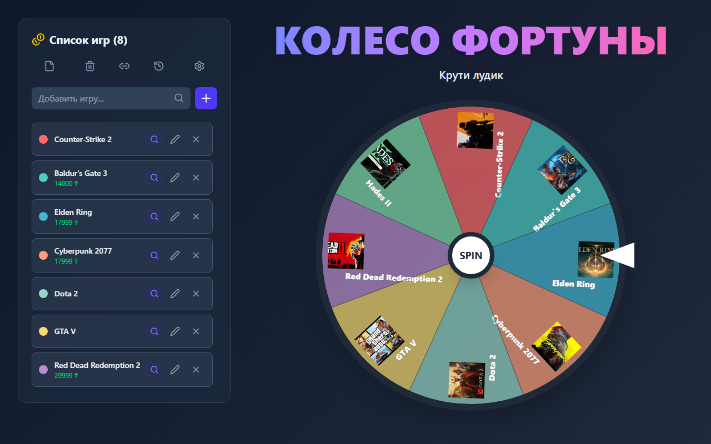

# 🎡 Колесо Фортуны

[](https://dvinerlove.github.io/fortune-wheel/)
[](https://dvinerlove.github.io/fortune-wheel/landing.html)
[](LICENSE)
[](https://react.dev)
[](https://www.typescriptlang.org)
[](https://vite.dev)

Веб-приложение для случайного выбора игры из списка: крутите колесо — оно решит, во что играть. Цены и скидки подтягиваются из Steam, внешний вид полностью настраивается, а всё состояние шарится одной короткой ссылкой.

**[▶ Открыть приложение](https://dvinerlove.github.io/fortune-wheel/)** · **[Промо-страница](https://dvinerlove.github.io/fortune-wheel/landing.html)**



## ✨ Возможности

- **Случайный выбор** — честный RNG (`crypto.getRandomValues`), плавная прокрутка с затуханием
- **Steam-интеграция** — автопоиск игры в Steam, живые цены и скидки в выбранном регионе, обложки на секторах колеса
- **Шаринг по ссылке** — короткая ссылка сохраняет список игр и все настройки (Supabase Edge Function + fallback на URL-state и localStorage)
- **Кастомизация** — свой фон и фон колеса (загрузка изображений), цвета рамки/указателя/текста, текст кнопки, позиция и длина названий, idle-вращение
- **Список игр** — добавление с автопривязкой к Steam, импорт списком, редактирование, подсказки маппинга
- **История** — все выпавшие игры с ценой и временем
- **Звук** — синтезированные звуки прокрутки и выигрыша (Web Audio API, без файлов)
- **PWA-friendly** — работает без регистрации, данные хранятся локально

## 🚀 Запуск

```bash
npm install
npm run dev        # http://localhost:5173/fortune-wheel/
```

Для Steam-цен и коротких ссылок нужен `VITE_API_URL` — см. [.env.example](.env.example) (Supabase Edge Function в `supabase/functions/fortune-wheel`).

## 📜 Скрипты

| Команда | Что делает |
|---|---|
| `npm run dev` | dev-сервер |
| `npm run build` | typecheck + прод-сборка в `dist/` |
| `npm run lint` | oxlint |
| `npm run preview` | предпросмотр сборки |
| `npm run deploy` | сборка + деплой на GitHub Pages |

## 🛠 Стек

React 19 · TypeScript · Vite 8 · Tailwind CSS 4 · Framer Motion · Lucide · Supabase Edge Functions · GitHub Pages (CI в `.github/workflows/deploy.yml`)

## 📄 Лицензия

[MIT](LICENSE)
